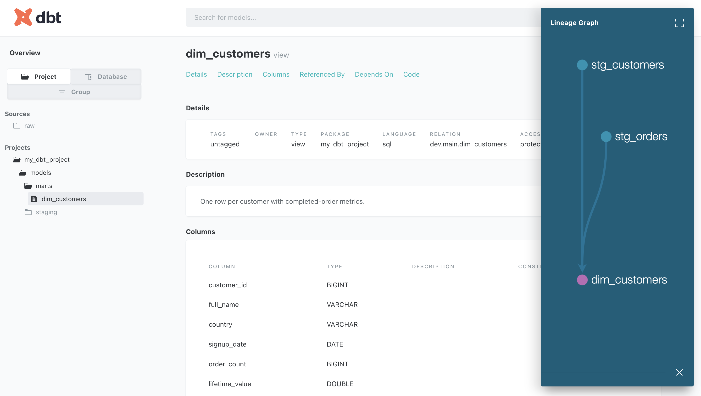

# dbt + DuckDB analytics project

A small ELT project that turns raw customer and order data into an analytics-ready customer dimension, built with dbt Core on DuckDB.

## Lineage



## Structure

- `raw` schema: synthetic customers and orders (generated by `create_raw_data.py`)
- `models/staging`: one cleaned model per source table; `stg_orders` is **incremental** (merges on `order_id`)
- `models/marts`: `dim_customers`, one row per customer with completed-order count and lifetime value (materialized as a table)
- Tests: `unique`, `not_null`, `relationships`, `accepted_values`

## Run it

```bash
python3 -m venv .venv && source .venv/bin/activate
pip install dbt-core dbt-duckdb
python create_raw_data.py
dbt build
dbt docs generate && dbt docs serve
```

## Decisions and trade-offs

- **DuckDB** for zero-setup local development. Models are warehouse-portable and can move to Snowflake by changing the adapter and profile.
- **Staging as views, marts as tables**: staging stays cheap and always fresh, marts are fast to query.
- **Incremental `stg_orders`** filters on `order_date`. This misses late-arriving rows older than the current max; a lookback window or a load-timestamp filter would fix that.

## Roadmap

- CI with GitHub Actions running `dbt build` on every PR
- Airflow orchestration
- Snowflake as the target warehouse
